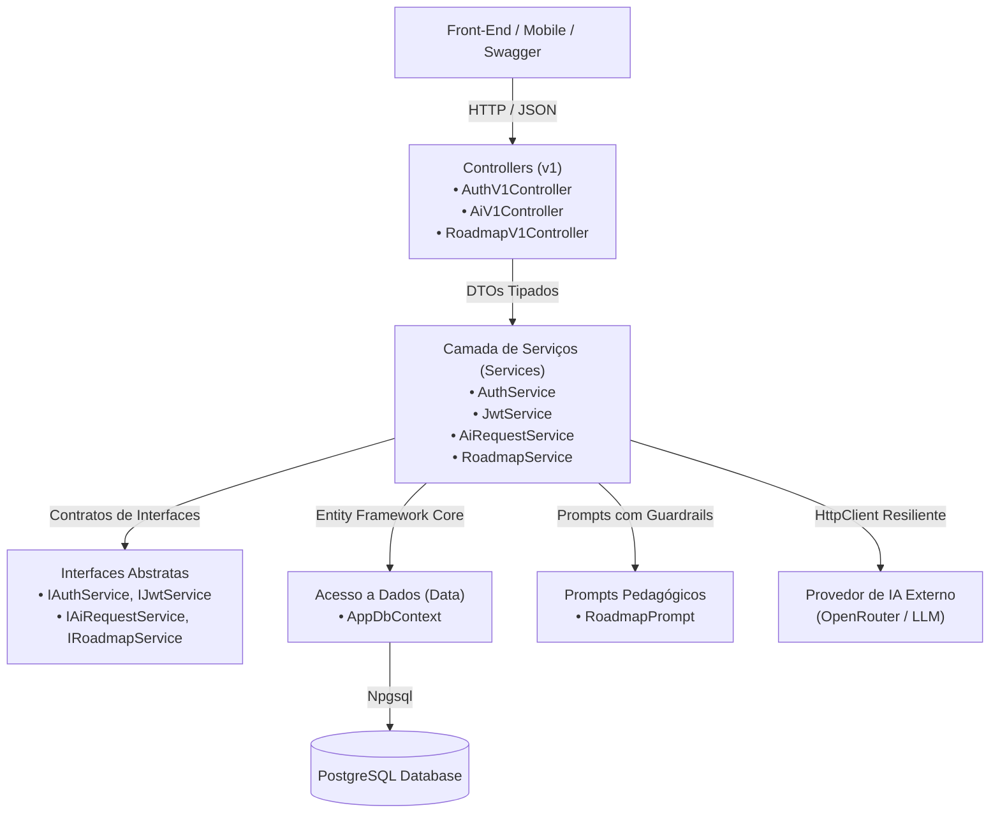
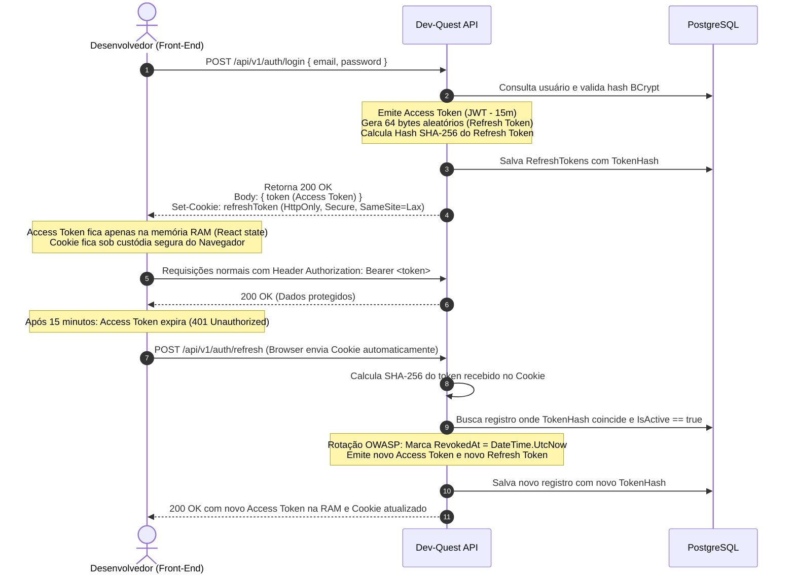
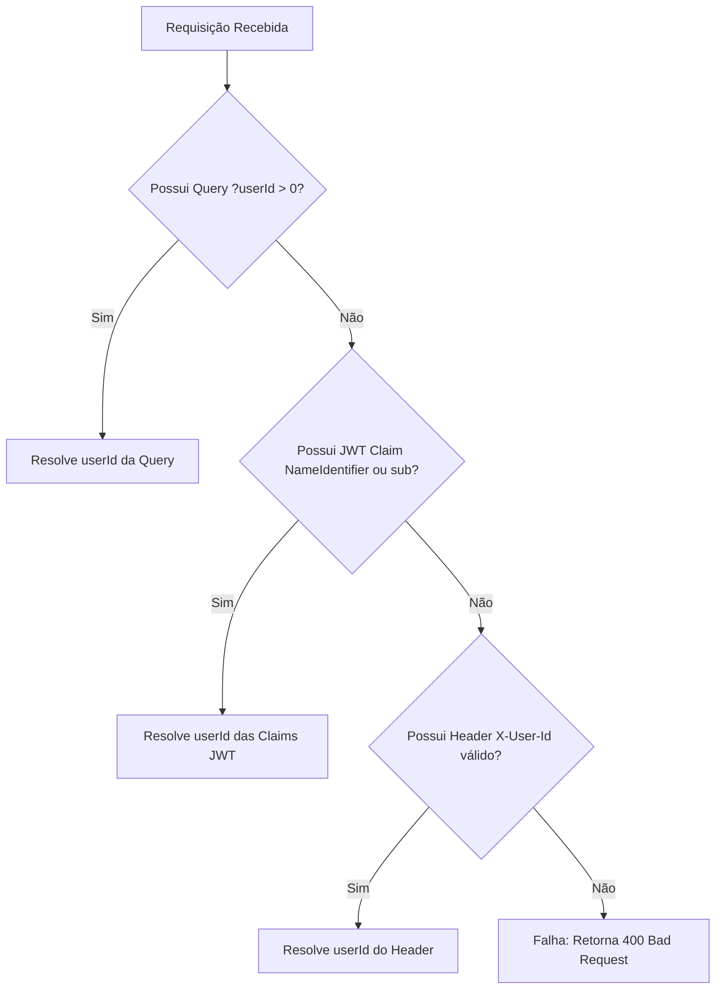

# Arquitetura e Engenharia de Software — Dev-Quest BackEnd

Este documento aprofunda as decisões arquiteturais, padrões de design, fluxo de segurança e estratégias pedagógicas implementadas no **Dev-Quest BackEnd**.

---

## 1. Visão Arquitetural em Camadas

O sistema adota uma separação rigorosa de responsabilidades baseada nos princípios de **Separation of Concerns (SoC)** e **Dependency Inversion (DIP)**:



---

## 2. Engenharia de Segurança de Sessão (Access Token + Refresh Token SHA-256)

Para proteger o usuário contra **XSS (Cross-Site Scripting)** e **CSRF (Cross-Site Request Forgery)**, o sistema utiliza a arquitetura de tokens híbrida recomendada pela OWASP:



### Regras de Segurança Aplicadas:
1. **Access Token Volátil (RAM):**
   - Assinado com `HmacSha256`, expira em **15 minutos**.
   - Contém claims essenciais: `sub`, `email`, `unique_name`, `nameid`, `jti`.
   - **Nunca** é gravado no `localStorage` ou `sessionStorage`.
2. **Refresh Token Criptográfico (Cookie HttpOnly):**
   - Expira em **7 dias**.
   - Possui flags de segurança: `HttpOnly = true` (inacessível via JavaScript), `Secure = true` (em HTTPS), `SameSite = SameSiteMode.Lax` e `Path = "/api/v1/auth"`.
3. **Armazenamento Seguro do Refresh Token (`TokenHash`):**
   - O banco de dados armazena **apenas o hash SHA-256 em formato hexadecimal**, nunca a chave em texto puro.
   - Mesmo na hipótese de um dump não autorizado do banco de dados, nenhum atacante conseguirá utilizar os tokens de sessão.
4. **Detecção de Reuso de Sessão:**
   - Se um token já revogado for apresentado para renovação, a tentativa é recusada (`401 Unauthorized`) e o cookie do cliente é removido.

---

## 3. Arquitetura do Motor Pedagógico de IA (Roadmaps)

A geração de trilhas de aprendizado combina Inteligência Artificial generativa com integridade relacional no banco de dados.

### 3.1. Tripla Separação de DTOs

Para garantir desacoplamento total entre o cliente HTTP, o modelo de linguagem e o banco relacional, a API adota 3 contratos distintos:

```text
┌──────────────────────────────────────┐
│ 1. CreateRoadmapRequestV1Dto         │  Entrada HTTP do cliente
│    (Specialty, Stack, Language, ...) │  Sem IDs, focado no objetivo didático
└──────────────────┬───────────────────┘
                   │
                   ▼
┌──────────────────────────────────────┐
│ 2. AiRoadmapOutputDto                │  Contrato com a saída JSON da IA
│    (title, description, topics, ...) │  Não conhece bancos, chaves PK/FK
└──────────────────┬───────────────────┘
                   │
                   ▼  (Validação de Schema + Transação Atômica EF Core)
┌──────────────────────────────────────┐
│ 3. CreateRoadmapResponseV1Dto        │  Saída HTTP para o Front-End
│    (RoadmapId, IdTopic, IdLesson...) │  Completo com IDs, XP e Progresso
└──────────────────────────────────────┘
```

### 3.2. Guardrails e Sanitização de Prompts (`RoadmapPrompt.cs`)
* **Prompt Injection Defense:** A classe `RoadmapPrompt` sanitiza os parâmetros de entrada (`Specialty`, `Stack`, `Language`) para remover tentativas de injeção de instruções maliciosas.
* **Schema JSON Estrito:** O system prompt instrui a IA a responder **estritamente em formato JSON puro**, sem markdown ou texto conversacional.
* **Fallback e Tratamento de Exceções:** Caso a IA responda fora do schema esperado, o `RoadmapService` captura a falha de desserialização com `JsonException`, registra logs de erro e devolve resposta amigável ao cliente sem quebrar a aplicação.

---

## 4. Resolução Híbrida de Identidade do Usuário

O método privado `TryResolveUserId` em `RoadmapV1Controller` suporta múltiplos canais de identificação para flexibilidade entre ambientes de teste, desenvolvimento e produção:


