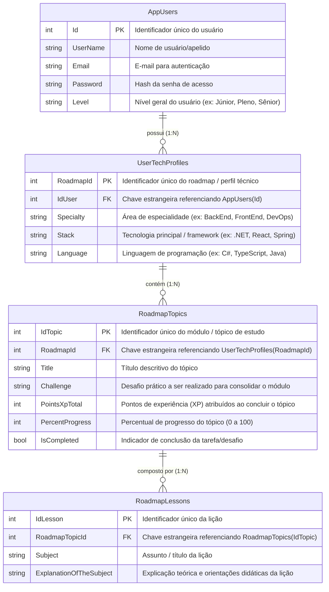

# Arquitetura de Dados - Dev-Quest

Este documento descreve o esquema de banco de dados relacional (PostgreSQL via Entity Framework Core), o diagrama de entidades e relacionamentos (ERD) e o fluxo detalhado das tabelas que compõem o ecossistema do **Dev-Quest**.

---

## 1. Diagrama Entidade-Relacionamento (ERD)



---

## 2. Visão Geral das Entidades e Tabelas

O banco de dados é modelado com quatro tabelas principais interligadas de forma hierárquica e progressiva:

| Entidade C# | Tabela no Banco | Descrição |
| :--- | :--- | :--- |
| `Users` | `AppUsers` | Armazena as credenciais de acesso, perfil e senioridade de cada usuário cadastrado. |
| `UserTechProfile` | `UserTechProfiles` | Representa a trilha de aprendizado (Roadmap) associada ao foco técnico do usuário (especialidade, stack e linguagem). |
| `RoadmapTopics` | `RoadmapTopics` | Representa os módulos e desafios práticos que compõem o Roadmap, com pontuação gamificada de XP e acompanhamento de progresso. |
| `RoadmapLessons` | `RoadmapLessons` | Contém o conteúdo didático e as lições detalhadas necessárias para que o usuário estude e resolva o desafio do tópico. |

---

## 3. Fluxo e Ciclo de Vida dos Dados

O fluxo operacional do sistema acontece em 5 etapas principais:

```
[ Usuário se Cadastra ]
         │
         ▼
[ Criação do Perfil Técnico ] ──► (Especialidade, Stack, Linguagem)
         │
         ▼
[ Geração de Roadmap via IA ] ──► (Criação de Tópicos e Lições)
         │
         ▼
[ Estudo das Lições & Desafio ] ──► (Consumo do conteúdo e execução prática)
         │
         ▼
[ Conclusão & Gamificação ] ──► (IsCompleted = true, XP atribuído, Progresso 100%)
```

### Passo a Passo do Fluxo:

1. **Autenticação e Registro do Desenvolvedor (`AppUsers`)**:
   - O usuário cria sua conta fornecendo nome, e-mail, senha e nível de senioridade (`Level`).
   - Esta tabela atua como o nó raiz para todas as atividades do usuário na plataforma.

2. **Definição de Trilha e Foco Técnico (`UserTechProfiles`)**:
   - Um usuário pode iniciar uma ou mais trilhas de estudos indicando sua especialidade (`Specialty`), stack (`Stack`) e linguagem (`Language`).
   - Cada perfil gera um identificador único de roadmap (`RoadmapId`), associado ao `IdUser`.

3. **Geração e Planejamento da Jornada de Estudos (`RoadmapTopics`)**:
   - Para cada perfil/roadmap cadastrado, o sistema (via prompts e inteligência artificial) gera tópicos estruturados pedagogicamente do nível fundamental ao avançado.
   - Cada tópico estabelece uma meta de aprendizado (`Title`), um desafio de código ou projeto simulando o mercado de trabalho (`Challenge`) e uma recompensa gamificada em XP (`PointsXpTotal`).
   - Inicialmente, `PercentProgress` começa em `0` e `IsCompleted` como `false`.

4. **Detalhamento do Conteúdo de Aprendizado (`RoadmapLessons`)**:
   - Cada tópico se desdobra em múltiplas lições (`RoadmapLessons`) associadas via `RoadmapTopicId`.
   - Cada lição fornece o assunto (`Subject`) e instruções práticas com explicação teórica (`ExplanationOfTheSubject`), servindo de guia de estudo para capacitar o desenvolvedor a resolver o desafio do tópico.

5. **Gamificação e Evolução de Progresso**:
   - Conforme o desenvolvedor estuda as lições e completa o desafio (`Challenge`), o `PercentProgress` do tópico avança até atingir a conclusão (`IsCompleted = true`), liberando os pontos de experiência (`PointsXpTotal`) para o progresso do usuário.

---

## 4. Regras de Integridade Relacional e Exclusão em Cascata (Cascade Delete)

Conforme configurado em `AppDbContext.cs`, todas as relações possuem exclusão em cascata (`DeleteBehavior.Cascade`):

- **Ao remover um Usuário (`AppUsers`)**:
  - Todos os perfis técnicos (`UserTechProfiles`), tópicos (`RoadmapTopics`) e lições (`RoadmapLessons`) vinculados são automaticamente excluídos, garantindo que não restem registros órfãos.
- **Ao remover um Perfil Técnico / Roadmap (`UserTechProfiles`)**:
  - Todos os tópicos (`RoadmapTopics`) e suas respectivas lições (`RoadmapLessons`) pertencentes àquele roadmap são removidos em cascata.
- **Ao remover um Tópico (`RoadmapTopics`)**:
  - Todas as lições (`RoadmapLessons`) filhas daquele tópico são excluídas.
