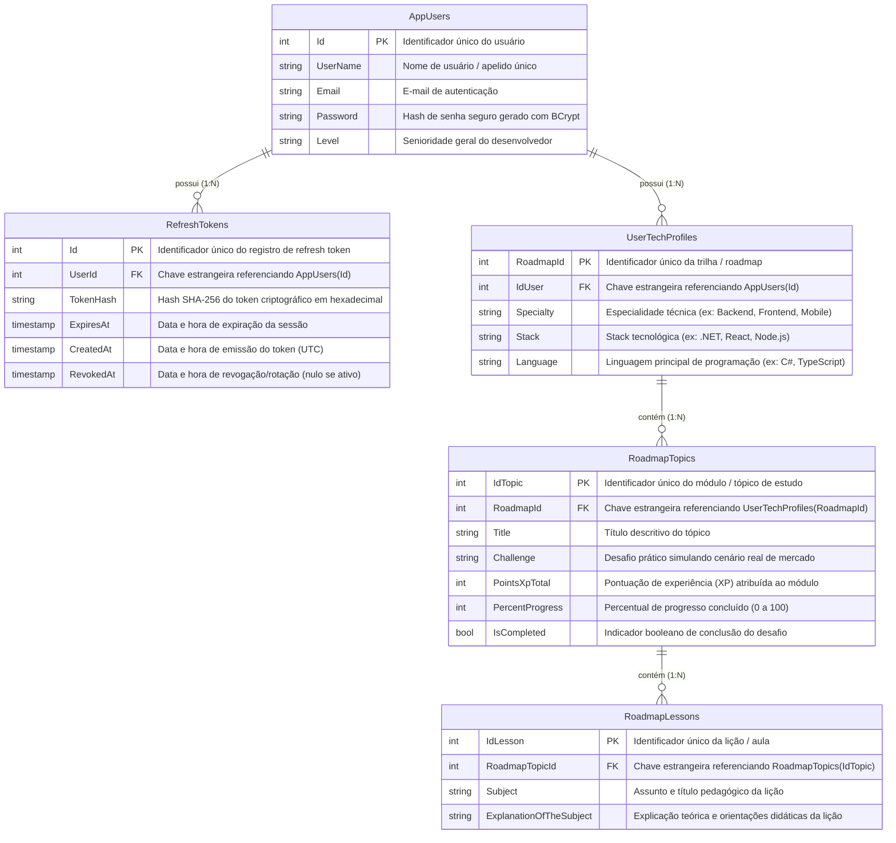
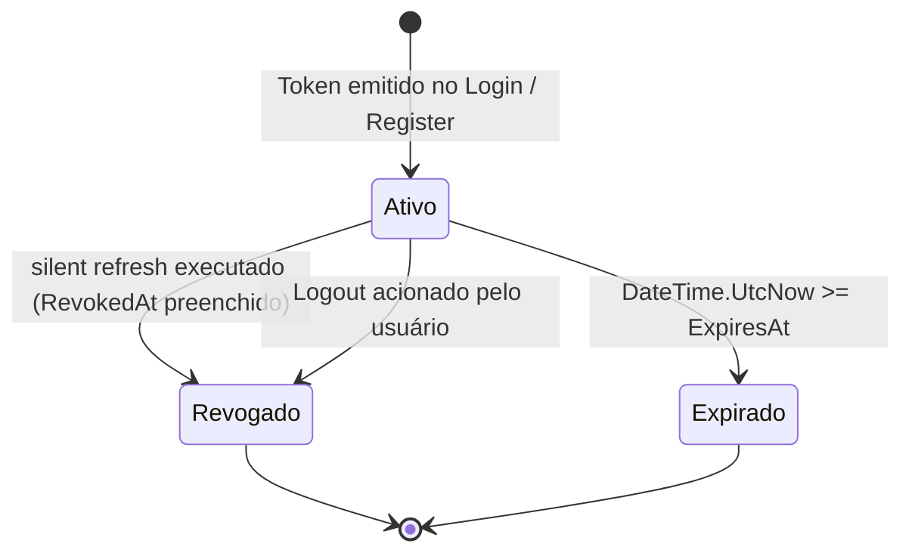

# Arquitetura de Dados e Esquema Relacional — Dev-Quest

Este documento descreve a modelagem de dados relacional (PostgreSQL via Entity Framework Core 10), o Diagrama Entidade-Relacionamento (ERD), o detalhamento das tabelas e o fluxo de integridade do ecossistema **Dev-Quest BackEnd**.

---

## 1. Diagrama Entidade-Relacionamento (ERD)



---

## 2. Visão Geral das Entidades e Tabelas

As entidades C# estão localizadas na pasta `Models/` e são mapeadas para o banco PostgreSQL através de `AppDbContext.cs`:

| Entidade C# | Tabela Física | Finalidade e Descrição |
| :--- | :--- | :--- |
| `Users` | `AppUsers` | Armazena as contas dos desenvolvedores (credenciais, e-mail e senioridade). Nó raiz de relacionamento. |
| `RefreshToken` | `RefreshTokens` | Persiste o estado das sessões ativas e histórico de rotação de tokens. **Armazena apenas o hash SHA-256 (`TokenHash`)** do token emitido. |
| `UserTechProfile` | `UserTechProfiles` | Representa uma trilha de aprendizagem personalizada associada ao foco técnico (especialidade, stack, linguagem) do usuário. |
| `RoadmapTopics` | `RoadmapTopics` | Representa os módulos progressivos gerados pela IA, contendo desafio prático, controle de progresso e gamificação com pontos de XP. |
| `RoadmapLessons` | `RoadmapLessons` | Contém as lições didáticas detalhadas subordinadas a cada tópico, servindo de base teórica para resolver o desafio. |

---

## 3. Segurança e Ciclo de Vida do Refresh Token

A tabela `RefreshTokens` segue as diretrizes da **OWASP para gerenciamento de sessões e prevenção de vazamento de credenciais**:

1. **Geração Segura:** A aplicação gera 64 bytes criptograficamente aleatórios via `RandomNumberGenerator` e codifica em Base64.
2. **Armazenamento com Hash (SHA-256):** O token em texto puro **nunca** é persistido no banco de dados. Apenas o hash hexadecimal SHA-256 é armazenado na coluna `TokenHash`.
3. **Tráfego Seguro via Cookie:** O token puro trafega exclusivamente via Cookie `HttpOnly; Secure; SameSite=Lax` com escopo restrito a `/api/v1/auth`.
4. **Validação na Renovação (`POST /api/v1/auth/refresh`):** Ao receber o cookie, a aplicação calcula o hash SHA-256 da string recebida e busca a linha correspondente no banco.
5. **Rotação Automática:** A sessão antiga é imediatamente invalidada marcando `RevokedAt = DateTime.UtcNow`, e um novo par de tokens é emitido.



---

## 4. Ciclo de Vida e Fluxo de Dados do Roadmap

```
[ Usuário Autenticado ]
          │
          ▼
[ POST /api/v1/roadmaps ] ──► (Specialty, Stack, Language, Level)
          │
          ▼
[ Geração via IA (OpenRouter) ] ──► Prompt estrito retorna JSON pedagógico
          │
          ▼
[ Transação Atômica no Banco (EF Core) ]
   ├── 1. Insere UserTechProfiles (gera RoadmapId)
   ├── 2. Insere RoadmapTopics (gera IdTopic, vincula RoadmapId, XP inicial)
   └── 3. Insere RoadmapLessons (gera IdLesson, vincula RoadmapTopicId)
          │
          ▼
[ Estudo das Lições e Execução do Desafio ]
          │
          ▼
[ Atualização de Progresso ] ──► (PercentProgress: 0 a 100%, IsCompleted = true, XP atribuído)
```

---

## 5. Regras de Integridade Relacional e Exclusão em Cascata (Cascade Delete)

Conforme configurado em `AppDbContext.cs`, todas as relações possuem exclusão em cascata (`DeleteBehavior.Cascade`):

* **Ao excluir um Usuário (`AppUsers`):**
  * Todos os `RefreshTokens` daquele usuário são removidos imediatamente.
  * Todas as trilhas (`UserTechProfiles`), tópicos (`RoadmapTopics`) e lições (`RoadmapLessons`) associadas são excluídas em cascata, eliminando registros órfãos.
* **Ao excluir um Perfil Técnico / Roadmap (`UserTechProfiles`):**
  * Todos os tópicos (`RoadmapTopics`) e lições (`RoadmapLessons`) filhas são excluídos.
* **Ao excluir um Tópico (`RoadmapTopics`):**
  * Todas as lições (`RoadmapLessons`) dependentes daquele tópico são excluídas.

---

## 6. Histórico de Migrações do Entity Framework Core

As modificações de estrutura do banco de dados são versionadas na pasta `Migrations/`:

| Data / Identificador | Migração | Descrição |
| :--- | :--- | :--- |
| `20261023125354` | `AddRefreshTokenTable` | Criação inicial da tabela `RefreshTokens` vinculada a `AppUsers`. |
| `20261120182825` | `RenameTokenToTokenHashInRefreshToken` | Renomeação da coluna `Token` para `TokenHash` para armazenar hash SHA-256. |
